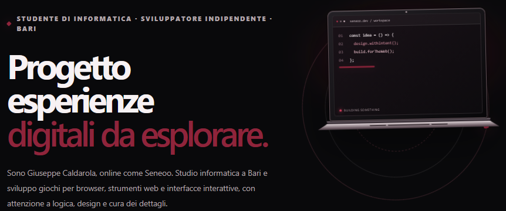

# ⚡ Seneo Lab

> *Browser games, useful web tools, streaming overlays, and software projects.*

---

## 🌐 About This Project / Informazioni sul Progetto
- **[EN]:** Seneo Lab is a standalone, single-file portfolio and interactive hub showcasing browser games, web utilities, OBS streaming overlays, and software projects developed by Giuseppe Caldarola (Seneoo).

- **[IT]:** Seneo Lab è un portfolio standalone in singolo file che raccoglie giochi per browser, utility web, overlay per OBS e progetti scolastici di programmazione sviluppati da Giuseppe Caldarola (Seneoo).

---

## ⚡ Main Features / Funzionalità Principali
- **Single-File Architecture / Architettura Single-File:**

  * *[EN]:* Completely contained within a single `index.html` file combining semantic HTML, advanced CSS custom properties, and optimized vanilla JavaScript.
  * *[IT]:* Completamente racchiuso in un unico file `index.html` che combina HTML semantico, CSS avanzato con custom properties e JavaScript vanilla ottimizzato.

- **Dynamic Search & Filtering / Ricerca e Filtri Dinamici:**

  * *[EN]:* Real-time search bar with instant suggestions and category filters for games, tools, OBS widgets, and school repositories.
  * *[IT]:* Barra di ricerca in tempo reale con suggerimenti istantanei e filtri per categoria (giochi, strumenti, widget OBS e repository scolastiche).

- **Theme Switcher / Cambio Tema:**

  * *[EN]:* Smooth day/night animated theme switcher with persistent local storage preferences.
  * *[IT]:* Interruttore giorno/notte animato con salvataggio delle preferenze tramite local storage.

- **Interactive Modals & Previews / Modali e Anteprime Interattive:**

  * *[EN]:* Detailed project inspection modals featuring technical breakdowns, controls, and direct repository/live links.
  * *[IT]:* Modali di dettaglio per ogni progetto con specifiche tecniche, comandi e collegamenti diretti al codice o alla versione live.

- **Responsive Design / Design Responsive:**

  * *[EN]:* Fluid layouts optimized for both desktop workstations and mobile touch devices.
  * *[IT]:* Layout fluidi ottimizzati sia per desktop che per dispositivi mobili touchscreen.

---

## 🛠️ Tech Stack / Tecnologie Utilizzate
- **HTML5 & CSS3:** Semantic markup, CSS grid/flexbox, custom properties, glassmorphism effects.
- **JavaScript (ES6+):** Vanilla JS handling DOM manipulation, event listeners, local storage, and dynamic rendering without external frameworks.

---

## 🔗 Links & Contacts

